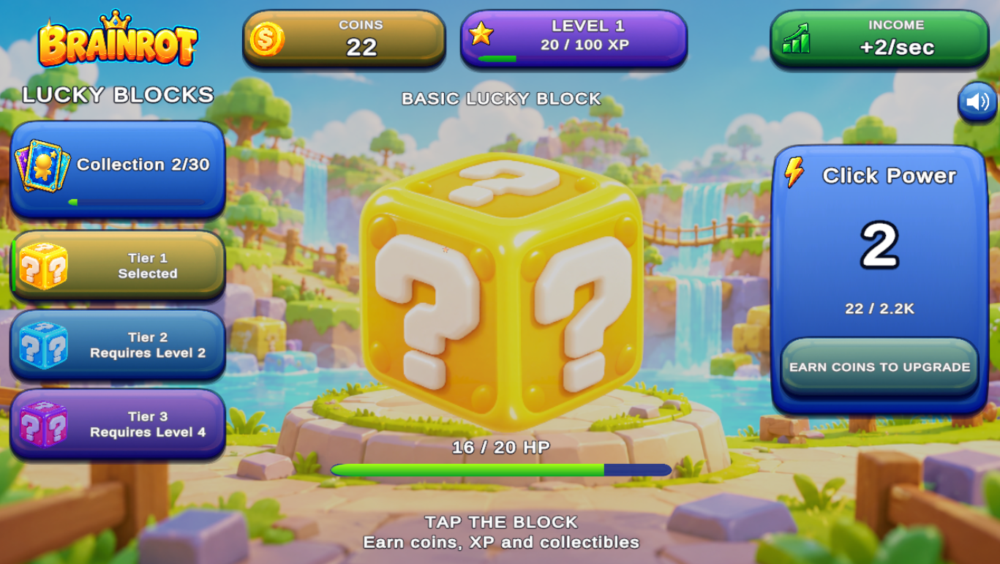
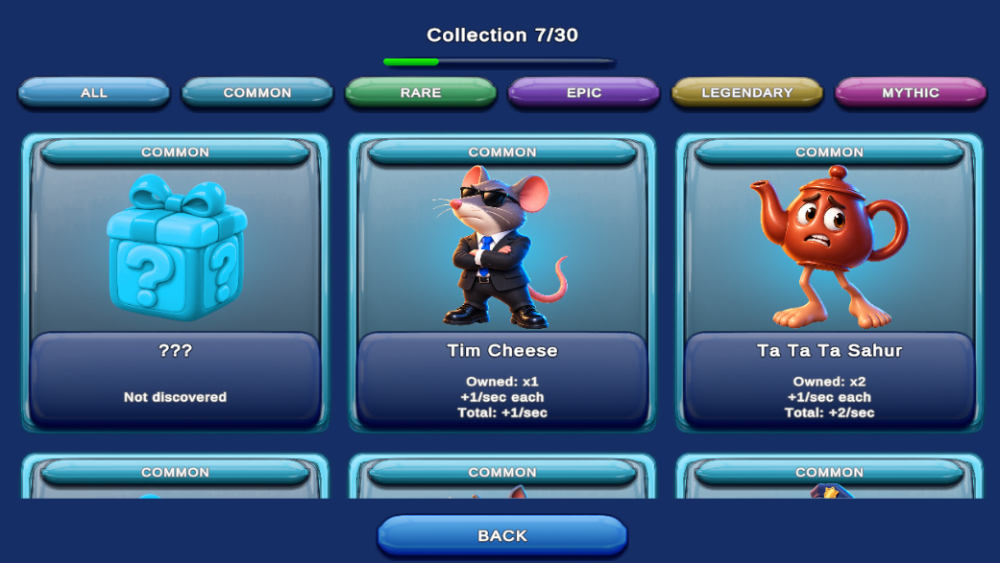
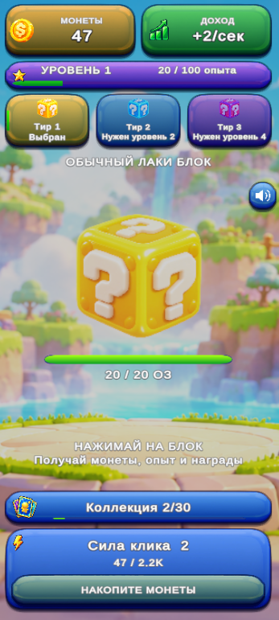

# 🎮 Brainrot Lucky Blocks

**A browser-based clicker and collection game built with Unity 6 and C#.**

Break Lucky Blocks, discover collectible characters, upgrade your clicking power, and build your collection!

##  Key Features

- **Lucky Blocks** — Break blocks to unlock random characters.
- **30 Collectible Characters** — Discover five rarity levels.
- **Progression System** — Earn XP, level up, and unlock new blocks.
- **Upgrades** — Improve click power and generate passive income.
- **Save System** — Automatically save progress and settings.
- **Responsive Design** — Optimized for desktop and mobile.
- **Localization** — English and Russian.
- **Audio** — Music, sound effects, and adjustable settings.

##  Technologies

- Unity 6 (URP)
- C#
- WebGL
- Git & GitHub

##  Screenshots

### Gameplay

### Character Collection

### Mobile Version

## 🚀 Play the Game

**Coming soon!**

Currently preparing for release on browser gaming platforms.

##  Development

Developed using an AI-assisted workflow, including game design, feature planning, implementation, testing, and optimization.

## 📌 Project Status

**Release Candidate — Pre-publication Testing**

*This repository is a public portfolio showcase. The Unity source code is maintained privately.*
